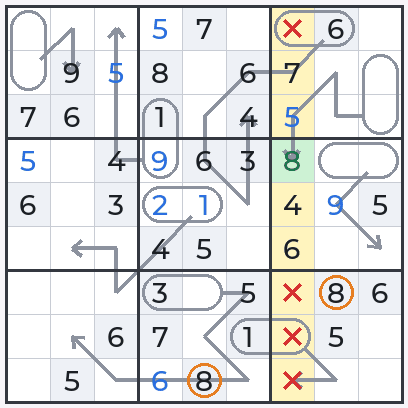

<!-- Written by tools/walkthrough.py pill-arrows: edit the script, not this page. -->
# Pill Arrows, step 10: the 8 in column 7

**Step 10 of 51** · [← Step 9](step-09.md) · [All steps](../pill-arrows.md#the-whole-puzzle-step-by-step) · [Step 11 →](step-11.md)

Column 7 needs an 8. r7c7: row 7 has one (r7c8). r8c7: box 9 has one (r7c8). r9c7: row 9 has one (r9c5). r1c7: it's a pill's first digit, its tens: a shaft of up to 7 cells adds up to 63 at most. Only **r4c7** is left: **r4c7 = 8**.

**Step 10 of 51** · [← Step 9](step-09.md) · [All steps](../pill-arrows.md#the-whole-puzzle-step-by-step) · [Step 11 →](step-11.md)
