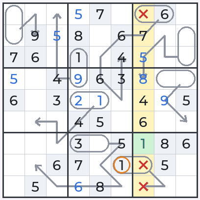

<!-- Written by tools/walkthrough.py pill-arrows: edit the script, not this page. -->
# Pill Arrows, step 11: the 1 in column 7

**Step 11 of 51** · [← Step 10](step-10.md) · [All steps](../pill-arrows.md#the-whole-puzzle-step-by-step) · [Step 12 →](step-12.md)

Column 7 needs a 1. r8c7: row 8 has one (r8c6). r1c7: it's the pill's first digit, its tens, and with a 1 there the shaft can't make the pill's number. r9c7: with a 1 on its shaft, the pill couldn't read as the shaft's sum. Only **r7c7** is left: **r7c7 = 1**.

**Step 11 of 51** · [← Step 10](step-10.md) · [All steps](../pill-arrows.md#the-whole-puzzle-step-by-step) · [Step 12 →](step-12.md)
