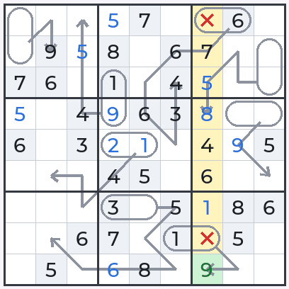

<!-- Written by tools/walkthrough.py pill-arrows: edit the script, not this page. -->
# Pill Arrows, step 12: the 9 in column 7

**Step 12 of 51** · [← Step 11](step-11.md) · [All steps](../pill-arrows.md#the-whole-puzzle-step-by-step) · [Step 13 →](step-13.md)

Column 7 needs a 9. r1c7: it's a pill's first digit, its tens: a shaft of up to 7 cells adds up to 63 at most. r8c7: it's the pill's second digit, and with a 9 there the shaft can't make the pill's number. Only **r9c7** is left: **r9c7 = 9**.

**Step 12 of 51** · [← Step 11](step-11.md) · [All steps](../pill-arrows.md#the-whole-puzzle-step-by-step) · [Step 13 →](step-13.md)
