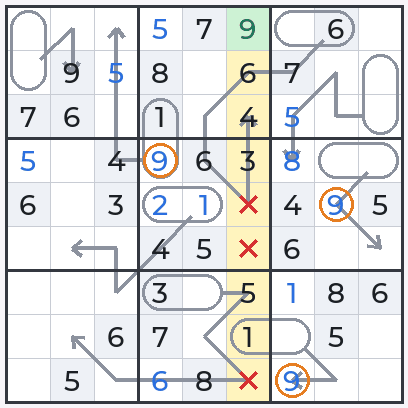

<!-- Written by tools/walkthrough.py pill-arrows: edit the script, not this page. -->
# Pill Arrows, step 13: the 9 in column 6

**Step 13 of 51** · [← Step 12](step-12.md) · [All steps](../pill-arrows.md#the-whole-puzzle-step-by-step) · [Step 14 →](step-14.md)

Column 6 needs a 9. r5c6: row 5 has one (r5c8). r6c6: box 5 has one (r4c4). r9c6: row 9 has one (r9c7). Only **r1c6** is left: **r1c6 = 9**.

**Step 13 of 51** · [← Step 12](step-12.md) · [All steps](../pill-arrows.md#the-whole-puzzle-step-by-step) · [Step 14 →](step-14.md)
