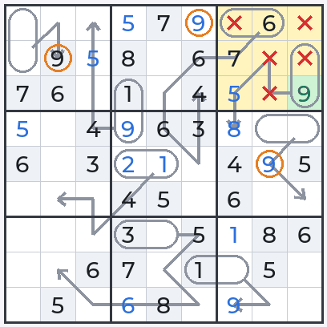

<!-- Written by tools/walkthrough.py pill-arrows: edit the script, not this page. -->
# Pill Arrows, step 14: the 9 in box 3

**Step 14 of 51** · [← Step 13](step-13.md) · [All steps](../pill-arrows.md#the-whole-puzzle-step-by-step) · [Step 15 →](step-15.md)

Box 3 needs a 9. r1c7 and r1c9: row 1 has one (r1c6). r2c8 and r2c9: row 2 has one (r2c2). r3c8: column 8 has one (r5c8). Only **r3c9** is left: **r3c9 = 9**.

**Step 14 of 51** · [← Step 13](step-13.md) · [All steps](../pill-arrows.md#the-whole-puzzle-step-by-step) · [Step 15 →](step-15.md)
