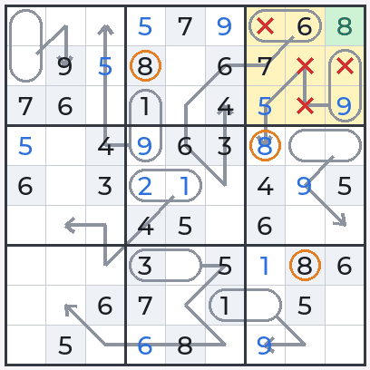

<!-- Written by tools/walkthrough.py pill-arrows: edit the script, not this page. -->
# Pill Arrows, step 15: the 8 in box 3

**Step 15 of 51** · [← Step 14](step-14.md) · [All steps](../pill-arrows.md#the-whole-puzzle-step-by-step) · [Step 16 →](step-16.md)

Box 3 needs an 8. r1c7: column 7 has one (r4c7). r2c8 and r2c9: row 2 has one (r2c4). r3c8: column 8 has one (r7c8). Only **r1c9** is left: **r1c9 = 8**.

**Step 15 of 51** · [← Step 14](step-14.md) · [All steps](../pill-arrows.md#the-whole-puzzle-step-by-step) · [Step 16 →](step-16.md)
