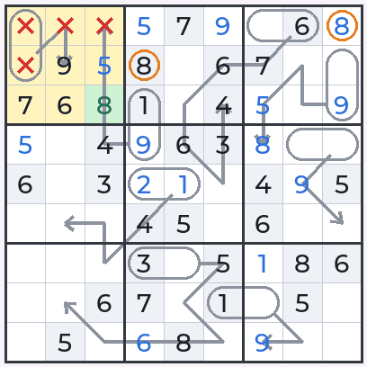

<!-- Written by tools/walkthrough.py pill-arrows: edit the script, not this page. -->
# Pill Arrows, step 16: the 8 in box 1

**Step 16 of 51** · [← Step 15](step-15.md) · [All steps](../pill-arrows.md#the-whole-puzzle-step-by-step) · [Step 17 →](step-17.md)

Box 1 needs an 8. r1c1, r1c2 and r1c3: row 1 has one (r1c9). r2c1: row 2 has one (r2c4). Only **r3c3** is left: **r3c3 = 8**.

**Step 16 of 51** · [← Step 15](step-15.md) · [All steps](../pill-arrows.md#the-whole-puzzle-step-by-step) · [Step 17 →](step-17.md)
