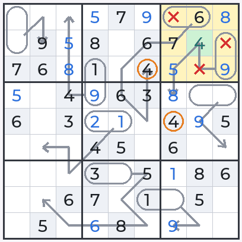

<!-- Written by tools/walkthrough.py pill-arrows: edit the script, not this page. -->
# Pill Arrows, step 17: the 4 in box 3

**Step 17 of 51** · [← Step 16](step-16.md) · [All steps](../pill-arrows.md#the-whole-puzzle-step-by-step) · [Step 18 →](step-18.md)

Box 3 needs a 4. r1c7: column 7 has one (r5c7). r3c8: row 3 has one (r3c6). r2c9: it's the pill's first digit, its tens: with a 4 there the pill would be 41 or more, more than its shaft of 4 cells can make. Only **r2c8** is left: **r2c8 = 4**.

**Step 17 of 51** · [← Step 16](step-16.md) · [All steps](../pill-arrows.md#the-whole-puzzle-step-by-step) · [Step 18 →](step-18.md)
