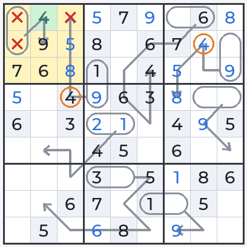

<!-- Written by tools/walkthrough.py pill-arrows: edit the script, not this page. -->
# Pill Arrows, step 18: the 4 in box 1

**Step 18 of 51** · [← Step 17](step-17.md) · [All steps](../pill-arrows.md#the-whole-puzzle-step-by-step) · [Step 19 →](step-19.md)

Box 1 needs a 4. r1c3: column 3 has one (r4c3). r2c1: row 2 has one (r2c8). r1c1: it's the pill's first digit, its tens: with a 4 there the pill would be 41 or more, more than its shaft of 2 cells can make. Only **r1c2** is left: **r1c2 = 4**.

**Step 18 of 51** · [← Step 17](step-17.md) · [All steps](../pill-arrows.md#the-whole-puzzle-step-by-step) · [Step 19 →](step-19.md)
