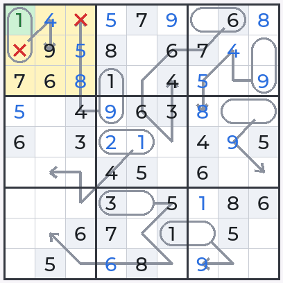

<!-- Written by tools/walkthrough.py pill-arrows: edit the script, not this page. -->
# Pill Arrows, step 19: the 1 in box 1

**Step 19 of 51** · [← Step 18](step-18.md) · [All steps](../pill-arrows.md#the-whole-puzzle-step-by-step) · [Step 20 →](step-20.md)

Box 1 needs a 1. r1c3: the pill reads 19 and the rest of the shaft makes 17, so it's 2. r2c1: it's the pill's second digit, and with a 1 there the shaft can't make the pill's number. Only **r1c1** is left: **r1c1 = 1**.

**Step 19 of 51** · [← Step 18](step-18.md) · [All steps](../pill-arrows.md#the-whole-puzzle-step-by-step) · [Step 20 →](step-20.md)
