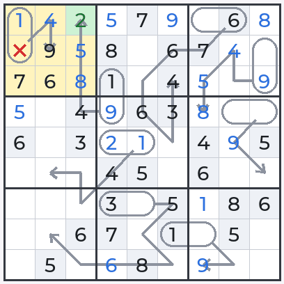

<!-- Written by tools/walkthrough.py pill-arrows: edit the script, not this page. -->
# Pill Arrows, step 20: the 2 in box 1

**Step 20 of 51** · [← Step 19](step-19.md) · [All steps](../pill-arrows.md#the-whole-puzzle-step-by-step) · [Step 21 →](step-21.md)

Box 1 needs a 2. r2c1: it's the pill's second digit: the shaft adds up to 13, so the pill is 13. Only **r1c3** is left: **r1c3 = 2**.

**Step 20 of 51** · [← Step 19](step-19.md) · [All steps](../pill-arrows.md#the-whole-puzzle-step-by-step) · [Step 21 →](step-21.md)
