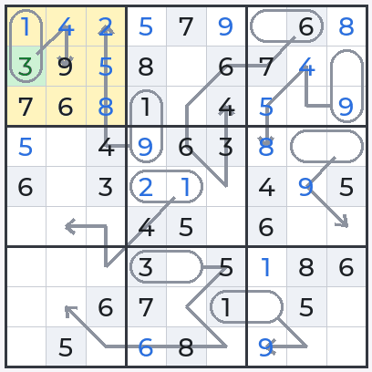

<!-- Written by tools/walkthrough.py pill-arrows: edit the script, not this page. -->
# Pill Arrows, step 21: the 3 in box 1

**Step 21 of 51** · [← Step 20](step-20.md) · [All steps](../pill-arrows.md#the-whole-puzzle-step-by-step) · [Step 22 →](step-22.md)

Box 1 needs a 3, and r2c1 is its last empty cell: **r2c1 = 3**.

**Step 21 of 51** · [← Step 20](step-20.md) · [All steps](../pill-arrows.md#the-whole-puzzle-step-by-step) · [Step 22 →](step-22.md)
