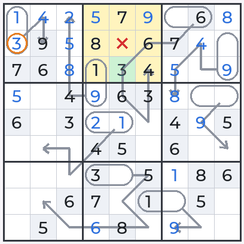

<!-- Written by tools/walkthrough.py pill-arrows: edit the script, not this page. -->
# Pill Arrows, step 22: the 3 in box 2

**Step 22 of 51** · [← Step 21](step-21.md) · [All steps](../pill-arrows.md#the-whole-puzzle-step-by-step) · [Step 23 →](step-23.md)

Box 2 needs a 3. r2c5: row 2 has one (r2c1). Only **r3c5** is left: **r3c5 = 3**.

**Step 22 of 51** · [← Step 21](step-21.md) · [All steps](../pill-arrows.md#the-whole-puzzle-step-by-step) · [Step 23 →](step-23.md)
