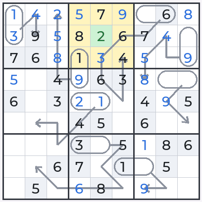

<!-- Written by tools/walkthrough.py pill-arrows: edit the script, not this page. -->
# Pill Arrows, step 23: the 2 in box 2

**Step 23 of 51** · [← Step 22](step-22.md) · [All steps](../pill-arrows.md#the-whole-puzzle-step-by-step) · [Step 24 →](step-24.md)

Box 2 needs a 2, and r2c5 is its last empty cell: **r2c5 = 2**.

**Step 23 of 51** · [← Step 22](step-22.md) · [All steps](../pill-arrows.md#the-whole-puzzle-step-by-step) · [Step 24 →](step-24.md)
