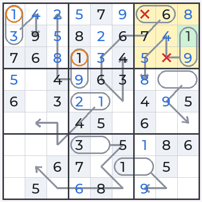

<!-- Written by tools/walkthrough.py pill-arrows: edit the script, not this page. -->
# Pill Arrows, step 24: the 1 in box 3

**Step 24 of 51** · [← Step 23](step-23.md) · [All steps](../pill-arrows.md#the-whole-puzzle-step-by-step) · [Step 25 →](step-25.md)

Box 3 needs a 1. r1c7: row 1 has one (r1c1). r3c8: row 3 has one (r3c4). Only **r2c9** is left: **r2c9 = 1**.

**Step 24 of 51** · [← Step 23](step-23.md) · [All steps](../pill-arrows.md#the-whole-puzzle-step-by-step) · [Step 25 →](step-25.md)
