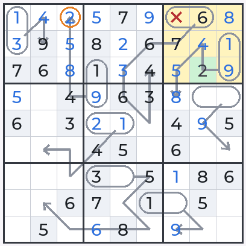

<!-- Written by tools/walkthrough.py pill-arrows: edit the script, not this page. -->
# Pill Arrows, step 25: the 2 in box 3

**Step 25 of 51** · [← Step 24](step-24.md) · [All steps](../pill-arrows.md#the-whole-puzzle-step-by-step) · [Step 26 →](step-26.md)

Box 3 needs a 2. r1c7: row 1 has one (r1c3). Only **r3c8** is left: **r3c8 = 2**.

**Step 25 of 51** · [← Step 24](step-24.md) · [All steps](../pill-arrows.md#the-whole-puzzle-step-by-step) · [Step 26 →](step-26.md)
