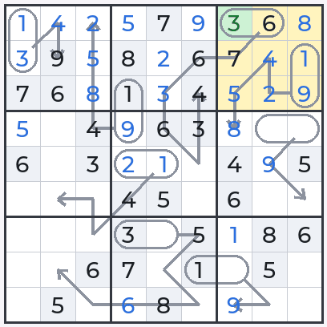

<!-- Written by tools/walkthrough.py pill-arrows: edit the script, not this page. -->
# Pill Arrows, step 26: the 3 in box 3

**Step 26 of 51** · [← Step 25](step-25.md) · [All steps](../pill-arrows.md#the-whole-puzzle-step-by-step) · [Step 27 →](step-27.md)

Box 3 needs a 3, and r1c7 is its last empty cell: **r1c7 = 3**.

**Step 26 of 51** · [← Step 25](step-25.md) · [All steps](../pill-arrows.md#the-whole-puzzle-step-by-step) · [Step 27 →](step-27.md)
