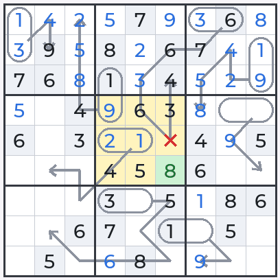

<!-- Written by tools/walkthrough.py pill-arrows: edit the script, not this page. -->
# Pill Arrows, step 27: the 8 in box 5

**Step 27 of 51** · [← Step 26](step-26.md) · [All steps](../pill-arrows.md#the-whole-puzzle-step-by-step) · [Step 28 →](step-28.md)

Box 5 needs an 8. r5c6: the pill reads 36 and the rest of the shaft makes 29, so it's 7. Only **r6c6** is left: **r6c6 = 8**.

**Step 27 of 51** · [← Step 26](step-26.md) · [All steps](../pill-arrows.md#the-whole-puzzle-step-by-step) · [Step 28 →](step-28.md)
