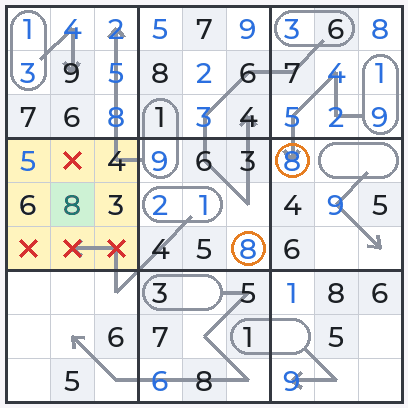

<!-- Written by tools/walkthrough.py pill-arrows: edit the script, not this page. -->
# Pill Arrows, step 28: the 8 in box 4

**Step 28 of 51** · [← Step 27](step-27.md) · [All steps](../pill-arrows.md#the-whole-puzzle-step-by-step) · [Step 29 →](step-29.md)

Box 4 needs an 8. r4c2: row 4 has one (r4c7). r6c1, r6c2 and r6c3: row 6 has one (r6c6). Only **r5c2** is left: **r5c2 = 8**.

**Step 28 of 51** · [← Step 27](step-27.md) · [All steps](../pill-arrows.md#the-whole-puzzle-step-by-step) · [Step 29 →](step-29.md)
