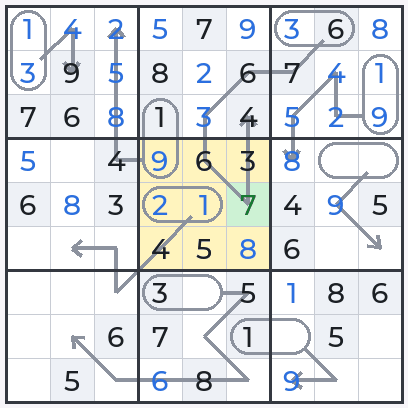

<!-- Written by tools/walkthrough.py pill-arrows: edit the script, not this page. -->
# Pill Arrows, step 29: the 7 in box 5

**Step 29 of 51** · [← Step 28](step-28.md) · [All steps](../pill-arrows.md#the-whole-puzzle-step-by-step) · [Step 30 →](step-30.md)

Box 5 needs a 7, and r5c6 is its last empty cell: **r5c6 = 7**.

**Step 29 of 51** · [← Step 28](step-28.md) · [All steps](../pill-arrows.md#the-whole-puzzle-step-by-step) · [Step 30 →](step-30.md)
