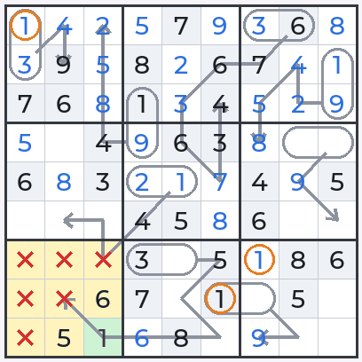

<!-- Written by tools/walkthrough.py pill-arrows: edit the script, not this page. -->
# Pill Arrows, step 30: the 1 in box 7

**Step 30 of 51** · [← Step 29](step-29.md) · [All steps](../pill-arrows.md#the-whole-puzzle-step-by-step) · [Step 31 →](step-31.md)

Box 7 needs a 1. r7c1, r7c2 and r7c3: row 7 has one (r7c7). r8c1 and r8c2: row 8 has one (r8c6). r9c1: column 1 has one (r1c1). Only **r9c3** is left: **r9c3 = 1**.

**Step 30 of 51** · [← Step 29](step-29.md) · [All steps](../pill-arrows.md#the-whole-puzzle-step-by-step) · [Step 31 →](step-31.md)
