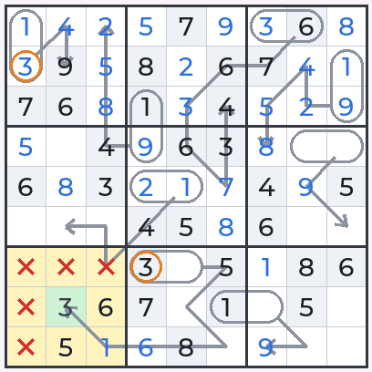

<!-- Written by tools/walkthrough.py pill-arrows: edit the script, not this page. -->
# Pill Arrows, step 31: the 3 in box 7

**Step 31 of 51** · [← Step 30](step-30.md) · [All steps](../pill-arrows.md#the-whole-puzzle-step-by-step) · [Step 32 →](step-32.md)

Box 7 needs a 3. r7c1, r7c2 and r7c3: row 7 has one (r7c4). r8c1 and r9c1: column 1 has one (r2c1). Only **r8c2** is left: **r8c2 = 3**.

**Step 31 of 51** · [← Step 30](step-30.md) · [All steps](../pill-arrows.md#the-whole-puzzle-step-by-step) · [Step 32 →](step-32.md)
