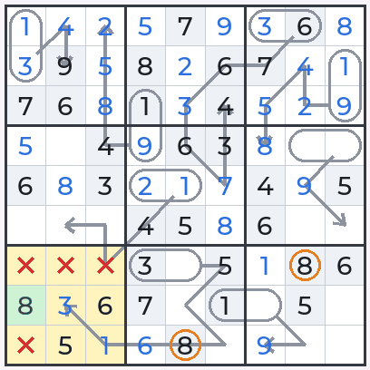

<!-- Written by tools/walkthrough.py pill-arrows: edit the script, not this page. -->
# Pill Arrows, step 32: the 8 in box 7

**Step 32 of 51** · [← Step 31](step-31.md) · [All steps](../pill-arrows.md#the-whole-puzzle-step-by-step) · [Step 33 →](step-33.md)

Box 7 needs an 8. r7c1, r7c2 and r7c3: row 7 has one (r7c8). r9c1: row 9 has one (r9c5). Only **r8c1** is left: **r8c1 = 8**.

**Step 32 of 51** · [← Step 31](step-31.md) · [All steps](../pill-arrows.md#the-whole-puzzle-step-by-step) · [Step 33 →](step-33.md)
