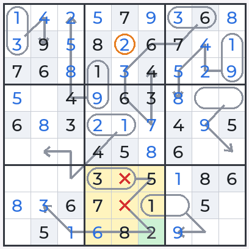

<!-- Written by tools/walkthrough.py pill-arrows: edit the script, not this page. -->
# Pill Arrows, step 33: the 2 in box 8

**Step 33 of 51** · [← Step 32](step-32.md) · [All steps](../pill-arrows.md#the-whole-puzzle-step-by-step) · [Step 34 →](step-34.md)

Box 8 needs a 2. r7c5 and r8c5: column 5 has one (r2c5). Only **r9c6** is left: **r9c6 = 2**.

**Step 33 of 51** · [← Step 32](step-32.md) · [All steps](../pill-arrows.md#the-whole-puzzle-step-by-step) · [Step 34 →](step-34.md)
