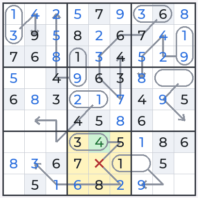

<!-- Written by tools/walkthrough.py pill-arrows: edit the script, not this page. -->
# Pill Arrows, step 34: the 4 in box 8

**Step 34 of 51** · [← Step 33](step-33.md) · [All steps](../pill-arrows.md#the-whole-puzzle-step-by-step) · [Step 35 →](step-35.md)

Box 8 needs a 4. r8c5: with a 4 on its shaft, the pill couldn't read as the shaft's sum. Only **r7c5** is left: **r7c5 = 4**.

**Step 34 of 51** · [← Step 33](step-33.md) · [All steps](../pill-arrows.md#the-whole-puzzle-step-by-step) · [Step 35 →](step-35.md)
