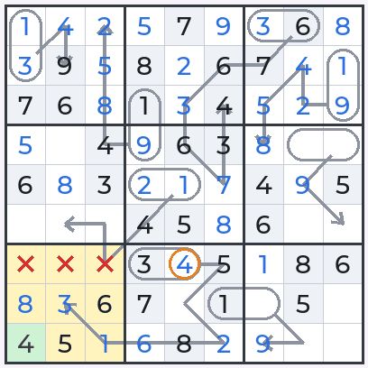

<!-- Written by tools/walkthrough.py pill-arrows: edit the script, not this page. -->
# Pill Arrows, step 35: the 4 in box 7

**Step 35 of 51** · [← Step 34](step-34.md) · [All steps](../pill-arrows.md#the-whole-puzzle-step-by-step) · [Step 36 →](step-36.md)

Box 7 needs a 4. r7c1, r7c2 and r7c3: row 7 has one (r7c5). Only **r9c1** is left: **r9c1 = 4**.

**Step 35 of 51** · [← Step 34](step-34.md) · [All steps](../pill-arrows.md#the-whole-puzzle-step-by-step) · [Step 36 →](step-36.md)
