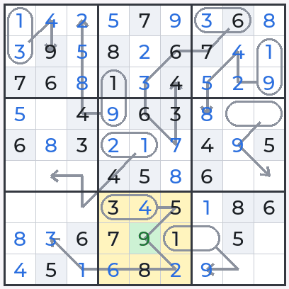

<!-- Written by tools/walkthrough.py pill-arrows: edit the script, not this page. -->
# Pill Arrows, step 36: the 9 in box 8

**Step 36 of 51** · [← Step 35](step-35.md) · [All steps](../pill-arrows.md#the-whole-puzzle-step-by-step) · [Step 37 →](step-37.md)

Box 8 needs a 9, and r8c5 is its last empty cell: **r8c5 = 9**.

**Step 36 of 51** · [← Step 35](step-35.md) · [All steps](../pill-arrows.md#the-whole-puzzle-step-by-step) · [Step 37 →](step-37.md)
