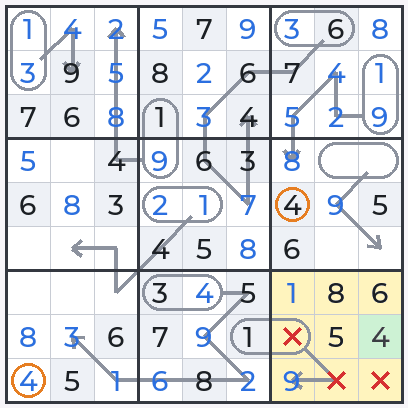

<!-- Written by tools/walkthrough.py pill-arrows: edit the script, not this page. -->
# Pill Arrows, step 37: the 4 in box 9

**Step 37 of 51** · [← Step 36](step-36.md) · [All steps](../pill-arrows.md#the-whole-puzzle-step-by-step) · [Step 38 →](step-38.md)

Box 9 needs a 4. r8c7: column 7 has one (r5c7). r9c8 and r9c9: row 9 has one (r9c1). Only **r8c9** is left: **r8c9 = 4**.

**Step 37 of 51** · [← Step 36](step-36.md) · [All steps](../pill-arrows.md#the-whole-puzzle-step-by-step) · [Step 38 →](step-38.md)
