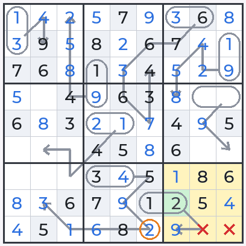

<!-- Written by tools/walkthrough.py pill-arrows: edit the script, not this page. -->
# Pill Arrows, step 38: the 2 in box 9

**Step 38 of 51** · [← Step 37](step-37.md) · [All steps](../pill-arrows.md#the-whole-puzzle-step-by-step) · [Step 39 →](step-39.md)

Box 9 needs a 2. r9c8 and r9c9: row 9 has one (r9c6). Only **r8c7** is left: **r8c7 = 2**.

**Step 38 of 51** · [← Step 37](step-37.md) · [All steps](../pill-arrows.md#the-whole-puzzle-step-by-step) · [Step 39 →](step-39.md)
