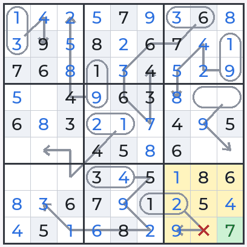

<!-- Written by tools/walkthrough.py pill-arrows: edit the script, not this page. -->
# Pill Arrows, step 39: the 7 in box 9

**Step 39 of 51** · [← Step 38](step-38.md) · [All steps](../pill-arrows.md#the-whole-puzzle-step-by-step) · [Step 40 →](step-40.md)

Box 9 needs a 7. r9c8: the pill reads 12 and the rest of the shaft makes 9, so it's 3. Only **r9c9** is left: **r9c9 = 7**.

**Step 39 of 51** · [← Step 38](step-38.md) · [All steps](../pill-arrows.md#the-whole-puzzle-step-by-step) · [Step 40 →](step-40.md)
