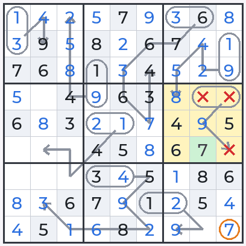

<!-- Written by tools/walkthrough.py pill-arrows: edit the script, not this page. -->
# Pill Arrows, step 40: the 7 in box 6

**Step 40 of 51** · [← Step 39](step-39.md) · [All steps](../pill-arrows.md#the-whole-puzzle-step-by-step) · [Step 41 →](step-41.md)

Box 6 needs a 7. r4c9 and r6c9: column 9 has one (r9c9). r4c8: it's a pill's first digit, its tens: a shaft of up to 7 cells adds up to 63 at most. Only **r6c8** is left: **r6c8 = 7**.

**Step 40 of 51** · [← Step 39](step-39.md) · [All steps](../pill-arrows.md#the-whole-puzzle-step-by-step) · [Step 41 →](step-41.md)
