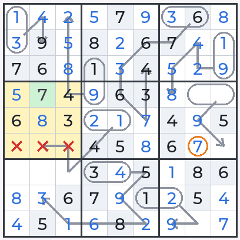

<!-- Written by tools/walkthrough.py pill-arrows: edit the script, not this page. -->
# Pill Arrows, step 41: the 7 in box 4

**Step 41 of 51** · [← Step 40](step-40.md) · [All steps](../pill-arrows.md#the-whole-puzzle-step-by-step) · [Step 42 →](step-42.md)

Box 4 needs a 7. r6c1, r6c2 and r6c3: row 6 has one (r6c8). Only **r4c2** is left: **r4c2 = 7**.

**Step 41 of 51** · [← Step 40](step-40.md) · [All steps](../pill-arrows.md#the-whole-puzzle-step-by-step) · [Step 42 →](step-42.md)
