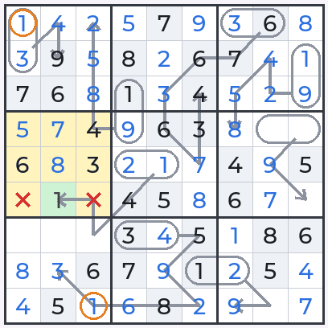

<!-- Written by tools/walkthrough.py pill-arrows: edit the script, not this page. -->
# Pill Arrows, step 42: the 1 in box 4

**Step 42 of 51** · [← Step 41](step-41.md) · [All steps](../pill-arrows.md#the-whole-puzzle-step-by-step) · [Step 43 →](step-43.md)

Box 4 needs a 1. r6c1: column 1 has one (r1c1). r6c3: column 3 has one (r9c3). Only **r6c2** is left: **r6c2 = 1**.

**Step 42 of 51** · [← Step 41](step-41.md) · [All steps](../pill-arrows.md#the-whole-puzzle-step-by-step) · [Step 43 →](step-43.md)
