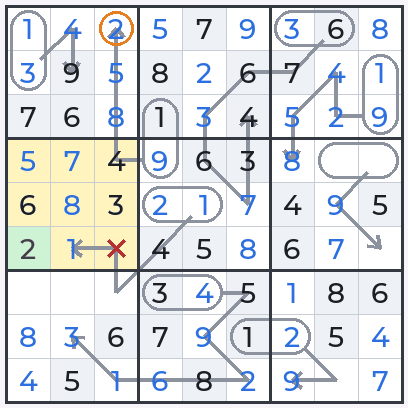

<!-- Written by tools/walkthrough.py pill-arrows: edit the script, not this page. -->
# Pill Arrows, step 43: the 2 in box 4

**Step 43 of 51** · [← Step 42](step-42.md) · [All steps](../pill-arrows.md#the-whole-puzzle-step-by-step) · [Step 44 →](step-44.md)

Box 4 needs a 2. r6c3: column 3 has one (r1c3). Only **r6c1** is left: **r6c1 = 2**.

**Step 43 of 51** · [← Step 42](step-42.md) · [All steps](../pill-arrows.md#the-whole-puzzle-step-by-step) · [Step 44 →](step-44.md)
