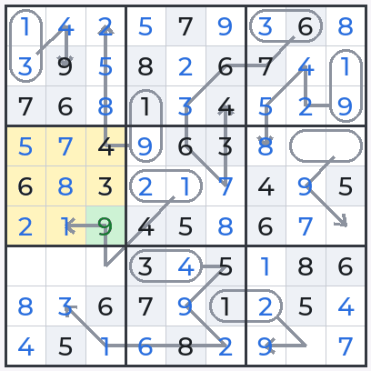

<!-- Written by tools/walkthrough.py pill-arrows: edit the script, not this page. -->
# Pill Arrows, step 44: the 9 in box 4

**Step 44 of 51** · [← Step 43](step-43.md) · [All steps](../pill-arrows.md#the-whole-puzzle-step-by-step) · [Step 45 →](step-45.md)

Box 4 needs a 9, and r6c3 is its last empty cell: **r6c3 = 9**.

**Step 44 of 51** · [← Step 43](step-43.md) · [All steps](../pill-arrows.md#the-whole-puzzle-step-by-step) · [Step 45 →](step-45.md)
