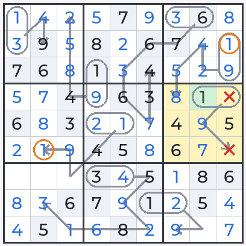

<!-- Written by tools/walkthrough.py pill-arrows: edit the script, not this page. -->
# Pill Arrows, step 45: the 1 in box 6

**Step 45 of 51** · [← Step 44](step-44.md) · [All steps](../pill-arrows.md#the-whole-puzzle-step-by-step) · [Step 46 →](step-46.md)

Box 6 needs a 1. r4c9: column 9 has one (r2c9). r6c9: row 6 has one (r6c2). Only **r4c8** is left: **r4c8 = 1**.

**Step 45 of 51** · [← Step 44](step-44.md) · [All steps](../pill-arrows.md#the-whole-puzzle-step-by-step) · [Step 46 →](step-46.md)
