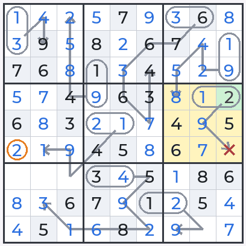

<!-- Written by tools/walkthrough.py pill-arrows: edit the script, not this page. -->
# Pill Arrows, step 46: the 2 in box 6

**Step 46 of 51** · [← Step 45](step-45.md) · [All steps](../pill-arrows.md#the-whole-puzzle-step-by-step) · [Step 47 →](step-47.md)

Box 6 needs a 2. r6c9: row 6 has one (r6c1). Only **r4c9** is left: **r4c9 = 2**.

**Step 46 of 51** · [← Step 45](step-45.md) · [All steps](../pill-arrows.md#the-whole-puzzle-step-by-step) · [Step 47 →](step-47.md)
