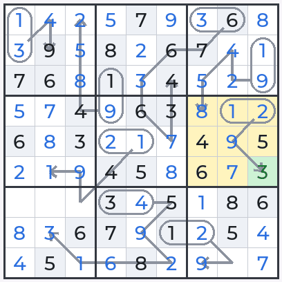

<!-- Written by tools/walkthrough.py pill-arrows: edit the script, not this page. -->
# Pill Arrows, step 47: the 3 in box 6

**Step 47 of 51** · [← Step 46](step-46.md) · [All steps](../pill-arrows.md#the-whole-puzzle-step-by-step) · [Step 48 →](step-48.md)

Box 6 needs a 3, and r6c9 is its last empty cell: **r6c9 = 3**.

**Step 47 of 51** · [← Step 46](step-46.md) · [All steps](../pill-arrows.md#the-whole-puzzle-step-by-step) · [Step 48 →](step-48.md)
