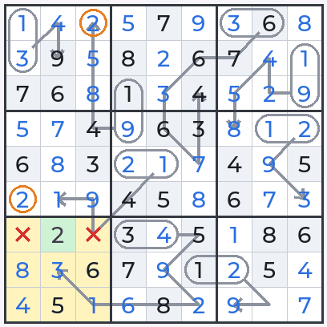

<!-- Written by tools/walkthrough.py pill-arrows: edit the script, not this page. -->
# Pill Arrows, step 48: the 2 in box 7

**Step 48 of 51** · [← Step 47](step-47.md) · [All steps](../pill-arrows.md#the-whole-puzzle-step-by-step) · [Step 49 →](step-49.md)

Box 7 needs a 2. r7c1: column 1 has one (r6c1). r7c3: column 3 has one (r1c3). Only **r7c2** is left: **r7c2 = 2**.

**Step 48 of 51** · [← Step 47](step-47.md) · [All steps](../pill-arrows.md#the-whole-puzzle-step-by-step) · [Step 49 →](step-49.md)
