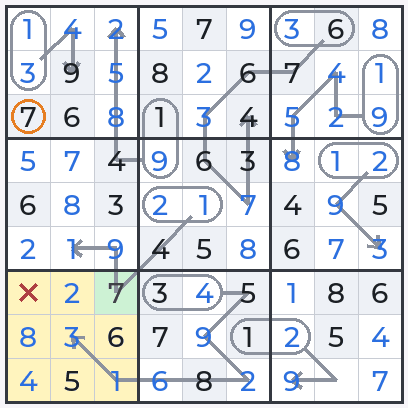

<!-- Written by tools/walkthrough.py pill-arrows: edit the script, not this page. -->
# Pill Arrows, step 49: the 7 in box 7

**Step 49 of 51** · [← Step 48](step-48.md) · [All steps](../pill-arrows.md#the-whole-puzzle-step-by-step) · [Step 50 →](step-50.md)

Box 7 needs a 7. r7c1: column 1 has one (r3c1). Only **r7c3** is left: **r7c3 = 7**.

**Step 49 of 51** · [← Step 48](step-48.md) · [All steps](../pill-arrows.md#the-whole-puzzle-step-by-step) · [Step 50 →](step-50.md)
