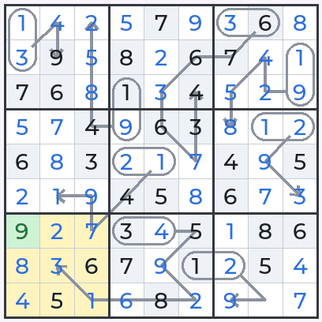

<!-- Written by tools/walkthrough.py pill-arrows: edit the script, not this page. -->
# Pill Arrows, step 50: the 9 in box 7

**Step 50 of 51** · [← Step 49](step-49.md) · [All steps](../pill-arrows.md#the-whole-puzzle-step-by-step) · [Step 51 →](step-51.md)

Box 7 needs a 9, and r7c1 is its last empty cell: **r7c1 = 9**.

**Step 50 of 51** · [← Step 49](step-49.md) · [All steps](../pill-arrows.md#the-whole-puzzle-step-by-step) · [Step 51 →](step-51.md)
