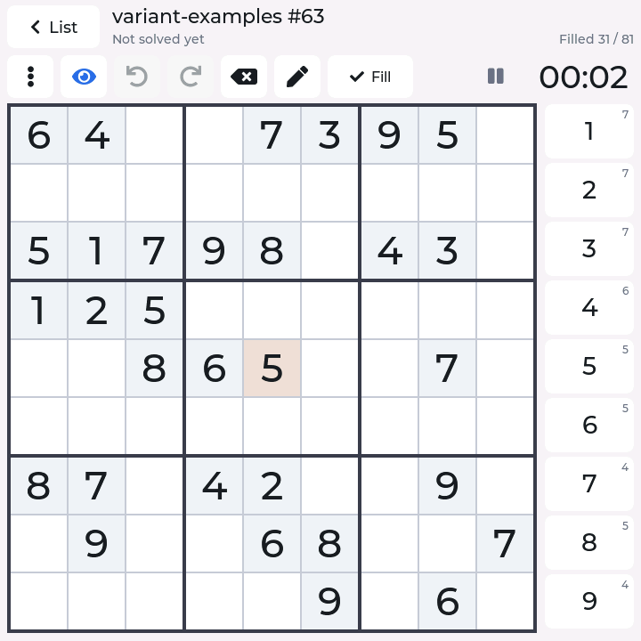
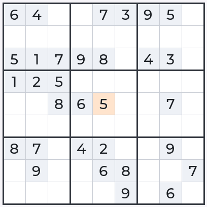

# Point Symmetry

[← All variants](README.md) · [Puzzles](../features-puzzles.md) · [How to play](../how-to-play.md)

## The rules

[Classic](classic.md) rules, and **two cells mirrored through the centre add up to 10**: turn the grid half a turn around its centre, and each cell lands on its mirror. r1c1 and r9c9 are mirrors, r1c4 and r9c6, r3c7 and r7c3. The centre cell (tinted) is its own mirror, so it's always **5**; 1 faces 9, 2 faces 8, 3 faces 7, 4 faces 6 and 5 faces 5.

## On the board

- The centre cell is tinted; nothing else is drawn.
- A pair of mirrored digits that doesn't add up to 10 turns red, and so does a centre that isn't 5.
- The grader and hints know one step: a cell keeps only the digits whose partner to 10 its mirror can still be. "Cells mirrored through the centre add up to 10. What row 9, column 6, the mirror of row 1, column 4, can be leaves it only 1."
- **Puzzles → ⋮ → New puzzle → Grids → Point Sym.** The puzzles give a cell or its mirror, seldom both: every given is really two, so they start with fewer of them than Classic's (about 11 to 13 below Easy).

## How to solve it

- **Mirror every given.** A digit gives its mirror away at once: 10 minus it. Fill those first, and the grid has twice as many digits.
- **Mirror the candidates too.** If a cell can only be 2 or 4, its mirror can only be 8 or 6.
- **The centre is 5**, so no other cell in row 5, column 5 or box 5 is.
- **Rows mirror rows.** Row 1 mirrors row 9 (reversed), row 2 row 8 and so on; row 5 mirrors itself, so its first and last cells add up to 10, the second and the eighth, and so on.

## Worked example

**variant-examples #63**, Point Symmetry Easy (see [Classic](classic.md#worked-example-the-whole-puzzle) for how to import the examples; cells are written r*row*c*column*).

**Step 1: r1c4.** Its mirror is r9c6, a given 9, and 9 needs a 1 to make 10. (By the Classic rules it could also be 2: row 1 has 6, 4, 7, 3, 9 and 5, and box 2 has 8.) **r1c4 = 1**.

**Step 2: r2c4.** Its mirror is r8c6, an 8: **r2c4 = 2**.

**Step 3: r2c1.** Its mirror is r8c9, a 7: **r2c1 = 3**.

Every given in this puzzle hands over its mirror the same way; once they're all filled in, the rest is a Classic puzzle with a lot of digits.

## The whole puzzle, step by step

<!-- walkthrough -->
<!-- Written by tools/walkthrough.py point-symmetry: edit the script, not this part. -->

The whole puzzle, from the start to the last cell: 50 steps, each one a single (one place left for a digit, or one digit left for a cell), taken in the order a box's single comes first, so not quite the order of the worked example above. Each step has a page of its own, with **Previous** and **Next**: pick its number below. In each picture, the unit the step looks at is tinted yellow (for a cell with one digit left: its row, column and box), the new digit is on green, the digits that rule cells out have an **orange ring**, and the empty cells they rule out a **red cross**. Givens are on grey, digits from earlier steps in blue.

| [1](point-symmetry/step-01.md) | [2](point-symmetry/step-02.md) | [3](point-symmetry/step-03.md) | [4](point-symmetry/step-04.md) | [5](point-symmetry/step-05.md) | [6](point-symmetry/step-06.md) | [7](point-symmetry/step-07.md) | [8](point-symmetry/step-08.md) | [9](point-symmetry/step-09.md) | [10](point-symmetry/step-10.md) |
|:-:|:-:|:-:|:-:|:-:|:-:|:-:|:-:|:-:|:-:|
| [11](point-symmetry/step-11.md) | [12](point-symmetry/step-12.md) | [13](point-symmetry/step-13.md) | [14](point-symmetry/step-14.md) | [15](point-symmetry/step-15.md) | [16](point-symmetry/step-16.md) | [17](point-symmetry/step-17.md) | [18](point-symmetry/step-18.md) | [19](point-symmetry/step-19.md) | [20](point-symmetry/step-20.md) |
| [21](point-symmetry/step-21.md) | [22](point-symmetry/step-22.md) | [23](point-symmetry/step-23.md) | [24](point-symmetry/step-24.md) | [25](point-symmetry/step-25.md) | [26](point-symmetry/step-26.md) | [27](point-symmetry/step-27.md) | [28](point-symmetry/step-28.md) | [29](point-symmetry/step-29.md) | [30](point-symmetry/step-30.md) |
| [31](point-symmetry/step-31.md) | [32](point-symmetry/step-32.md) | [33](point-symmetry/step-33.md) | [34](point-symmetry/step-34.md) | [35](point-symmetry/step-35.md) | [36](point-symmetry/step-36.md) | [37](point-symmetry/step-37.md) | [38](point-symmetry/step-38.md) | [39](point-symmetry/step-39.md) | [40](point-symmetry/step-40.md) |
| [41](point-symmetry/step-41.md) | [42](point-symmetry/step-42.md) | [43](point-symmetry/step-43.md) | [44](point-symmetry/step-44.md) | [45](point-symmetry/step-45.md) | [46](point-symmetry/step-46.md) | [47](point-symmetry/step-47.md) | [48](point-symmetry/step-48.md) | [49](point-symmetry/step-49.md) | [50](point-symmetry/step-50.md) |

Solved.

<!-- /walkthrough -->
