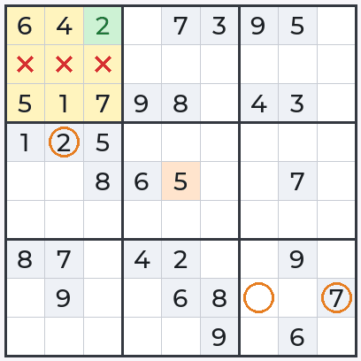

<!-- Written by tools/walkthrough.py point-symmetry: edit the script, not this page. -->
# Point Symmetry, step 1: the 2 in box 1

**Step 1 of 50** · [← The start](../point-symmetry.md#the-whole-puzzle-step-by-step) · [All steps](../point-symmetry.md#the-whole-puzzle-step-by-step) · [Step 2 →](step-02.md)

Box 1 needs a 2. r2c2: column 2 has one (r4c2). r2c1: its mirror through the centre, r8c9, is 7: a 2 there wouldn't make 10. r2c3: its mirror through the centre, r8c7, can't be 8, which a 2 would need. Only **r1c3** is left: **r1c3 = 2**.

**Step 1 of 50** · [← The start](../point-symmetry.md#the-whole-puzzle-step-by-step) · [All steps](../point-symmetry.md#the-whole-puzzle-step-by-step) · [Step 2 →](step-02.md)
