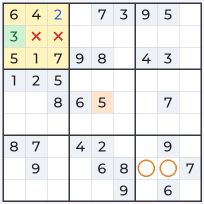

<!-- Written by tools/walkthrough.py point-symmetry: edit the script, not this page. -->
# Point Symmetry, step 2: the 3 in box 1

**Step 2 of 50** · [← Step 1](step-01.md) · [All steps](../point-symmetry.md#the-whole-puzzle-step-by-step) · [Step 3 →](step-03.md)

Box 1 needs a 3. r2c2: its mirror through the centre, r8c8, can't be 7, which a 3 would need. r2c3: its mirror through the centre, r8c7, can't be 7, which a 3 would need. Only **r2c1** is left: **r2c1 = 3**.

**Step 2 of 50** · [← Step 1](step-01.md) · [All steps](../point-symmetry.md#the-whole-puzzle-step-by-step) · [Step 3 →](step-03.md)
