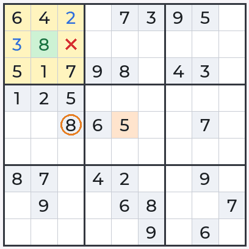

<!-- Written by tools/walkthrough.py point-symmetry: edit the script, not this page. -->
# Point Symmetry, step 3: the 8 in box 1

**Step 3 of 50** · [← Step 2](step-02.md) · [All steps](../point-symmetry.md#the-whole-puzzle-step-by-step) · [Step 4 →](step-04.md)

Box 1 needs an 8. r2c3: column 3 has one (r5c3). Only **r2c2** is left: **r2c2 = 8**.

**Step 3 of 50** · [← Step 2](step-02.md) · [All steps](../point-symmetry.md#the-whole-puzzle-step-by-step) · [Step 4 →](step-04.md)
