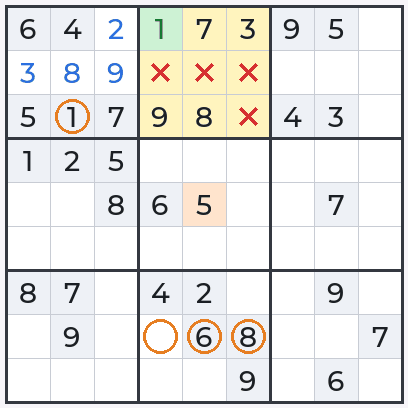

<!-- Written by tools/walkthrough.py point-symmetry: edit the script, not this page. -->
# Point Symmetry, step 5: the 1 in box 2

**Step 5 of 50** · [← Step 4](step-04.md) · [All steps](../point-symmetry.md#the-whole-puzzle-step-by-step) · [Step 6 →](step-06.md)

Box 2 needs a 1. r3c6: row 3 has one (r3c2). r2c4: its mirror through the centre, r8c6, is 8: a 1 there wouldn't make 10. r2c5: its mirror through the centre, r8c5, is 6: a 1 there wouldn't make 10. r2c6: its mirror through the centre, r8c4, can't be 9, which a 1 would need. Only **r1c4** is left: **r1c4 = 1**.

**Step 5 of 50** · [← Step 4](step-04.md) · [All steps](../point-symmetry.md#the-whole-puzzle-step-by-step) · [Step 6 →](step-06.md)
