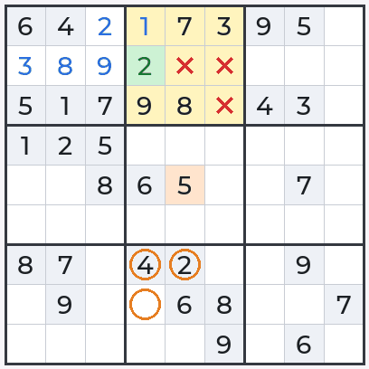

<!-- Written by tools/walkthrough.py point-symmetry: edit the script, not this page. -->
# Point Symmetry, step 6: the 2 in box 2

**Step 6 of 50** · [← Step 5](step-05.md) · [All steps](../point-symmetry.md#the-whole-puzzle-step-by-step) · [Step 7 →](step-07.md)

Box 2 needs a 2. r2c5: column 5 has one (r7c5). r2c6: its mirror through the centre, r8c4, can't be 8, which a 2 would need. r3c6: its mirror through the centre, r7c4, is 4: a 2 there wouldn't make 10. Only **r2c4** is left: **r2c4 = 2**.

**Step 6 of 50** · [← Step 5](step-05.md) · [All steps](../point-symmetry.md#the-whole-puzzle-step-by-step) · [Step 7 →](step-07.md)
