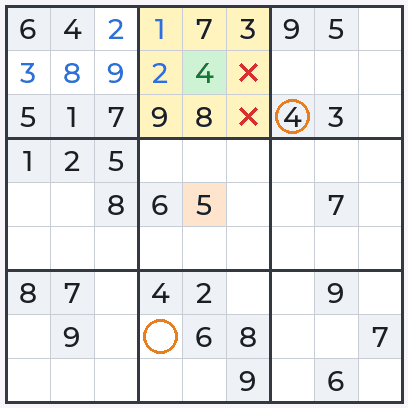

<!-- Written by tools/walkthrough.py point-symmetry: edit the script, not this page. -->
# Point Symmetry, step 7: the 4 in box 2

**Step 7 of 50** · [← Step 6](step-06.md) · [All steps](../point-symmetry.md#the-whole-puzzle-step-by-step) · [Step 8 →](step-08.md)

Box 2 needs a 4. r3c6: row 3 has one (r3c7). r2c6: its mirror through the centre, r8c4, can't be 6, which a 4 would need. Only **r2c5** is left: **r2c5 = 4**.

**Step 7 of 50** · [← Step 6](step-06.md) · [All steps](../point-symmetry.md#the-whole-puzzle-step-by-step) · [Step 8 →](step-08.md)
