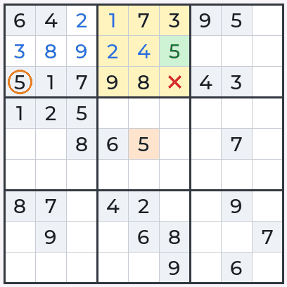

<!-- Written by tools/walkthrough.py point-symmetry: edit the script, not this page. -->
# Point Symmetry, step 8: the 5 in box 2

**Step 8 of 50** · [← Step 7](step-07.md) · [All steps](../point-symmetry.md#the-whole-puzzle-step-by-step) · [Step 9 →](step-09.md)

Box 2 needs a 5. r3c6: row 3 has one (r3c1). Only **r2c6** is left: **r2c6 = 5**.

**Step 8 of 50** · [← Step 7](step-07.md) · [All steps](../point-symmetry.md#the-whole-puzzle-step-by-step) · [Step 9 →](step-09.md)
