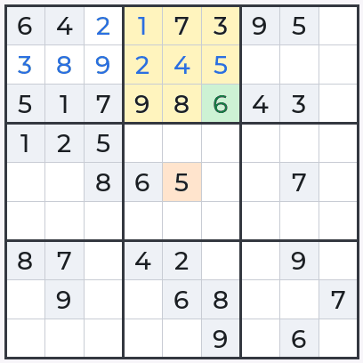

<!-- Written by tools/walkthrough.py point-symmetry: edit the script, not this page. -->
# Point Symmetry, step 9: the 6 in box 2

**Step 9 of 50** · [← Step 8](step-08.md) · [All steps](../point-symmetry.md#the-whole-puzzle-step-by-step) · [Step 10 →](step-10.md)

Box 2 needs a 6, and r3c6 is its last empty cell: **r3c6 = 6**.

**Step 9 of 50** · [← Step 8](step-08.md) · [All steps](../point-symmetry.md#the-whole-puzzle-step-by-step) · [Step 10 →](step-10.md)
